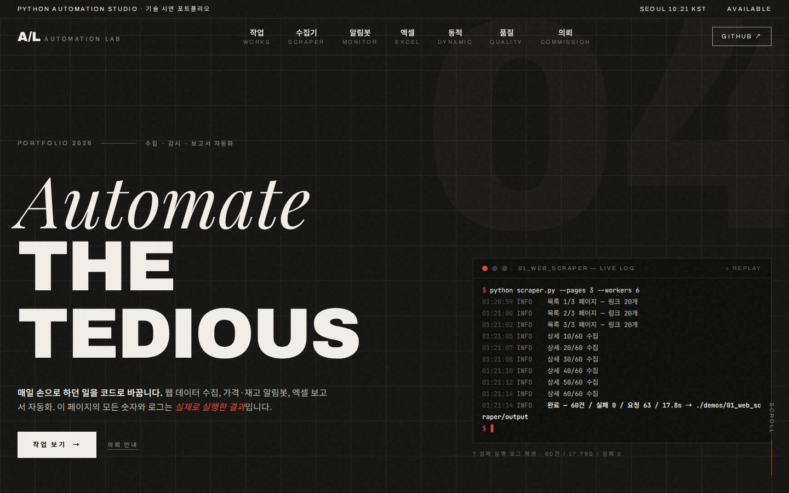
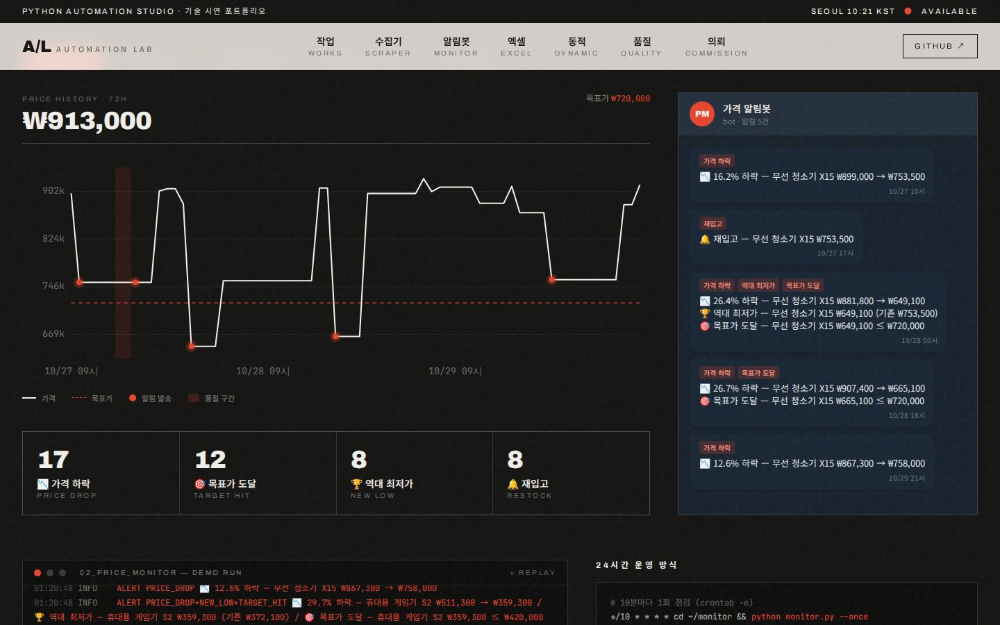
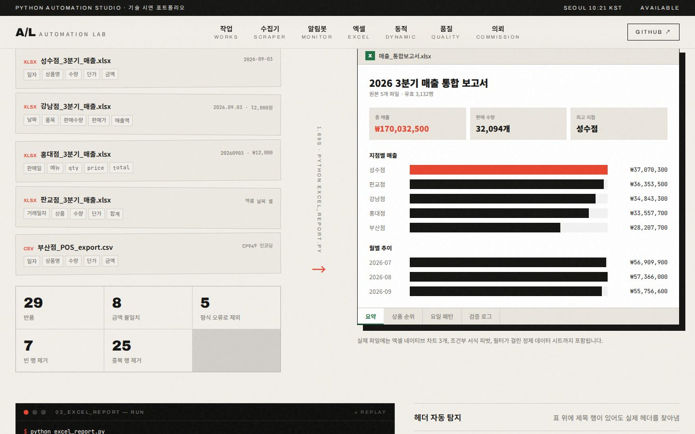
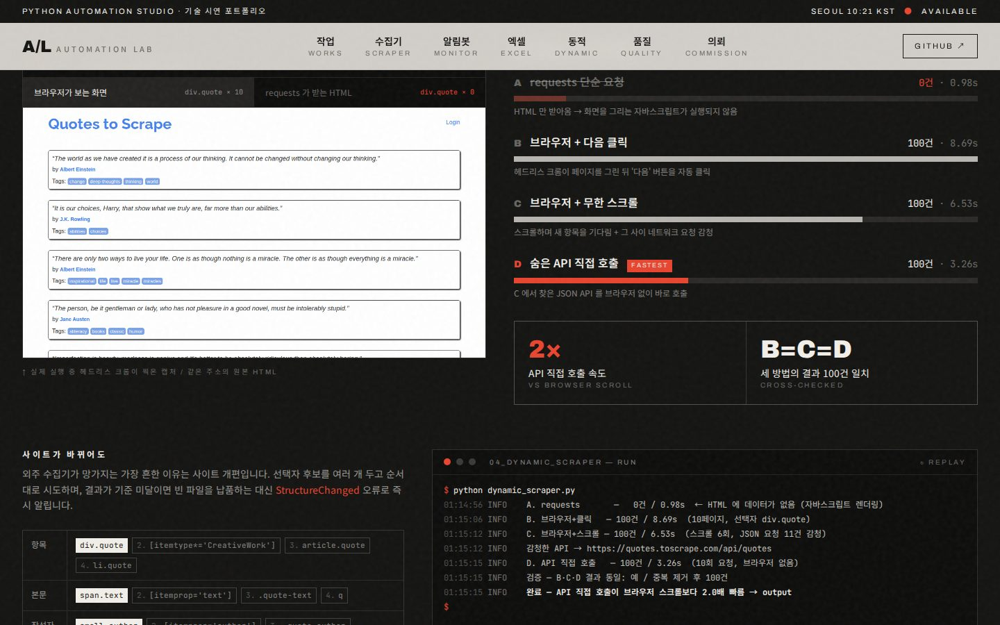
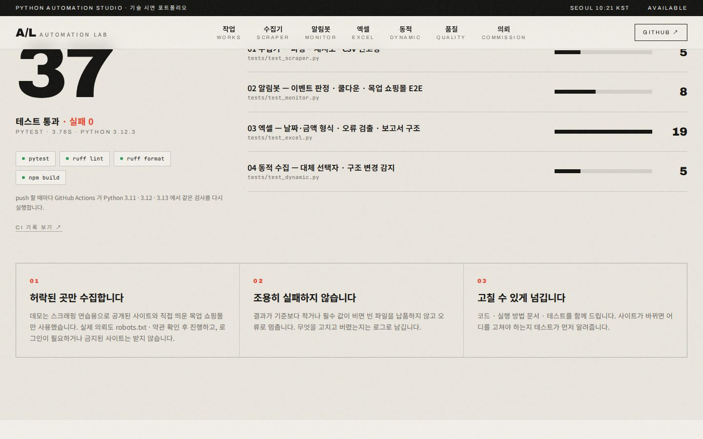

# AUTOMATION LAB — Automate the Tedious

> 반복 업무를 코드로 바꾸는 파이썬 자동화 포트폴리오.
> 외주에서 가장 많이 요청되는 네 가지 유형을 **실제로 구현하고 돌려본 결과**를 공개합니다.

[](https://github.com/YOUR_ID/automation-portfolio/actions/workflows/tests.yml)
  

**🔗 쇼케이스 사이트:** `https://YOUR_ID.github.io/automation-portfolio/`



| # | 데모 | 한 줄 요약 | 실행 결과 |
|---|------|-----------|-----------|
| 01 | [웹 데이터 수집기](demos/01_web_scraper) | 목록 → 상세 2단계 병렬 수집, 재시도·딜레이·robots.txt 준수 | 60건 / 16초 / 실패 0 |
| 02 | [가격·재고 알림봇](demos/02_price_monitor) | 가격 하락·목표가·최저가·재입고 감지 → 텔레그램 | 360회 점검 → 이벤트 45 → 알림 27 |
| 03 | [엑셀 보고서 자동화](demos/03_excel_report) | 양식 제각각인 파일 5개 → 차트 포함 통합 보고서 | 3,132행 정제 · 74건 처리 · 1.7초 |
| 04 | [동적 페이지 수집](demos/04_dynamic_scraper) | JS 렌더링 · 무한 스크롤 · 숨은 API 역추적 · 구조 변경 감지 | requests 0건 → 브라우저 100건 → API 2배 빠름 |

---

## 빠른 실행

```bash
python3 -m venv .venv && source .venv/bin/activate
pip install -r requirements.txt

# 01 — 웹 수집 (books.toscrape.com: 스크래핑 연습용 공개 사이트)
python demos/01_web_scraper/scraper.py --pages 3

# 02 — 알림봇 (로컬 목업 쇼핑몰로 72시간 시뮬레이션, 외부 사이트 호출 없음)
cd demos/02_price_monitor && python monitor.py --demo --cycles 72 && cd -

# 03 — 엑셀 자동화
cd demos/03_excel_report && python make_sample_data.py && python excel_report.py && cd -

# 04 — 동적 페이지 (최초 1회 브라우저 설치 필요)
python -m playwright install chromium
python demos/04_dynamic_scraper/dynamic_scraper.py

# 테스트 · 린트
pip install pytest ruff && pytest && ruff check .
```

각 데모는 `output/` 에 결과 파일과 `run_summary.json`, `run.log` 를 남깁니다.

## 쇼케이스 사이트

사이트의 숫자·로그·차트는 하드코딩이 아니라 위 실행 결과에서 생성됩니다. 테스트 통과 수도 내보낼 때 pytest 를 실제로 실행해서 기록합니다.

```bash
python scripts/export_showcase.py   # demos/*/output → site/src/data/showcase.json
cd site && npm install && npm run dev
```

`main` 브랜치에 push 하면 GitHub Actions 가 테스트(Python 3.11–3.13)를 돌리고, `site/` 를 빌드해 GitHub Pages 로 배포합니다
(저장소 Settings → Pages → Source: **GitHub Actions** 한 번만 설정).

공개 전 `site/src/config.ts` 에서 저장소 주소와 연락처만 바꾸면 됩니다.

| 알림봇 | 엑셀 자동화 |
|---|---|
|  |  |
| **동적 페이지** | **품질** |
|  |  |

## 구조

```
demos/
  01_web_scraper/     scraper.py · output/(books.csv · books.xlsx · books.json)
  02_price_monitor/   monitor.py · mock_shop.py · targets.json · output/(history.json · alerts.jsonl)
  03_excel_report/    make_sample_data.py · excel_report.py · input/ · output/매출_통합보고서.xlsx
  04_dynamic_scraper/ dynamic_scraper.py · output/(quotes.csv · rendered.png)
tests/                pytest 37개 — 파싱 · 재시도 · 이벤트 판정 · 엑셀 검증 · 구조 변경 감지
scripts/
  export_showcase.py  실행 결과 + 테스트 결과 → 사이트 데이터
site/                 React 19 · Vite · Tailwind CSS 4 쇼케이스
```

## 원칙

- **허용된 범위만 수집** — robots.txt 확인, 요청 간 딜레이, 로그인·약관상 금지된 사이트는 다루지 않습니다.
  데모가 스크래핑 연습용 공개 사이트와 직접 띄운 목업 쇼핑몰만 쓰는 것도 같은 이유입니다.
- **조용히 실패하지 않게** — 결과가 기준 미달이면 빈 파일을 납품하지 않고 `StructureChanged` 로 멈춥니다.
- **멈추지 않게** — 재시도·지수 백오프, 실패한 항목만 기록하고 나머지는 계속 진행.
- **기록을 남기게** — 무엇을 수집·변경·제외했는지 로그와 검증 시트로 확인 가능.

## License

MIT
